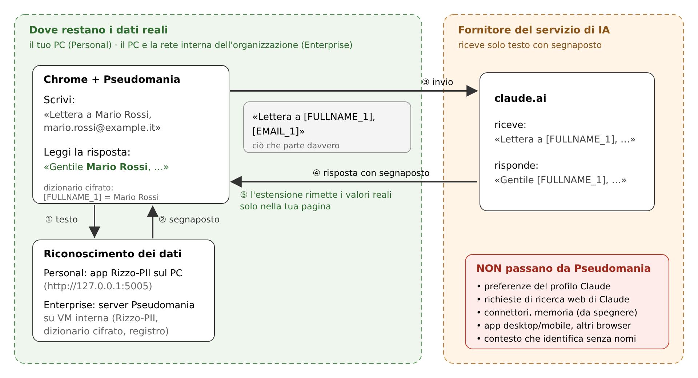

# 1. Cos'è e come funziona

## 1.1 In una frase

**Pseudomania** è un'estensione per Google Chrome che, quando usi **claude.ai**, sostituisce
automaticamente i dati personali che riconosce con **segnaposto** prima dell'invio e rimette i
**dati reali** nelle risposte di Claude, solo sullo schermo del tuo computer.

Sito ufficiale: <https://pseudomania.statocritico.it> · Licenza: AGPL-3.0-or-later.

## 1.2 Lo schema

1. **Scrivi** in claude.ai come al solito (testo, allegati, istruzioni e file dei progetti).
2. Al momento dell'invio l'estensione passa il testo al **servizio di riconoscimento**: l'app
   desktop **Rizzo-PII** sul tuo PC (Personal edition) oppure il **server Pseudomania**
   dell'organizzazione sulla rete interna (Server edition).
3. I dati riconosciuti diventano **segnaposto** nella forma `[TIPO_N]`, per esempio
   `[FULLNAME_1]` (nome e cognome), `[EMAIL_1]`, `[CF_1]` (codice fiscale), `[IBAN_1]`. Lo
   stesso valore, nella stessa conversazione o nello stesso progetto, riceve sempre lo stesso
   segnaposto.
4. A claude.ai parte **solo il testo con i segnaposto**, preceduto (nel primo messaggio di ogni
   conversazione) da un'istruzione fissa che chiede a Claude di riportare i segnaposto senza
   modificarli.
5. Quando arriva la risposta, l'estensione sostituisce i segnaposto con i valori reali **nella
   pagina** (evidenziati in verde). La corrispondenza segnaposto → valore (il **dizionario**) è
   cifrata e non lascia mai il tuo controllo in chiaro.

## 1.3 Le due edizioni

| | **Personal edition** | **Server edition** |
|---|---|---|
| Per chi | singolo professionista, piccola organizzazione | enti pubblici e imprese |
| Componenti | estensione + app desktop **Rizzo-PII** sul PC | estensione imposta da policy di Chrome + **server** su VM interna + Langfuse (facoltativo) |
| Riconoscimento | sul PC (`http://127.0.0.1:5005`) | sul server dell'organizzazione |
| Dizionario | nel browser, cifrato con chiave locale | sul server, **cifrato nel browser** con chiave utente automatica; copia di custodia apribile solo da due custodi |
| Registro | locale, cifrato, senza testi | registro minimo sul server senza testi + tracce pseudonimizzate brevi (Langfuse) |
| Si può spegnere? | sì: parte disattivata e si attiva per singola conversazione con un clic o Alt+Maiusc+P (il ripristino resta sempre attivo) | no: pulsante bloccato su acceso dalla policy |
| Se il riconoscimento non risponde | avviso e richiesta di conferma | invio **bloccato** (*fail-closed*) |
| Server Pseudomania, Docker | **nessuno** | sì |

## 1.4 Che cosa viene riconosciuto

Il riconoscimento è affidato a **Rizzo-PII**, un modello open source specializzato in dati
personali in italiano. I tipi di segnaposto previsti sono: `FULLNAME`, `EMAIL`, `TELEPHONENUM`,
`STREET`, `BUILDINGNUM`, `ZIPCODE`, `CITY`, `PROVINCE`, `IBAN`, `CREDITCARDNUMBER`, `AMOUNT`, `CF`,
`PIVA`, `CATASTO`, `DOCID`, `ID_DOC`, `ORG`, `DATE`, `TIME`, `TARGA`, `AGE`, `GENDER`, `URL`,
`IPADDR`.

Alcuni termini pubblici (enti, istituzioni) sono in un **elenco di eccezioni** (*allowlist*) e
non vengono mai mascherati.

Inoltre un **filtro delle categorie particolari** (salute, disabilità, dati genetici o biometrici,
origine etnica, opinioni politiche, convinzioni religiose, appartenenza sindacale, vita sessuale,
condanne penali e reati: artt. 9 e 10 GDPR) **blocca l'invio** quando trova certe parole: questi
dati non devono essere inviati nemmeno pseudonimizzati, perché il contesto resta un dato
particolare («[FULLNAME_1] è in malattia per depressione»). Le regole sono una **bozza** da
validare con il DPO.

## 1.5 Che cosa viene protetto e che cosa no

| Protetto (passa dall'estensione) | **Non** protetto |
|---|---|
| messaggi, modifiche e reinvii | **preferenze personali del profilo Claude** |
| allegati DOCX, XLSX, TXT, CSV, MD; PDF e, nella Personal edition, immagini (vedi §2.7 e §4.3) | **richieste di ricerca web** che Claude formula da sé |
| istruzioni e file dei **progetti** | **connettori** (Google Drive, Gmail…) e **memoria** di Claude: vanno spenti |
| testo lungo incollato che claude.ai trasforma in allegato | **app desktop e mobile** di Claude, altri browser, modalità in incognito |
| download di file DOCX/XLSX/testo generati da Claude (ripristino; nella Personal edition anche PDF) | **testo nelle immagini** nella Server edition (bloccate o inviate dopo una conferma, mai analizzate); nella Personal edition l'oscuramento con OCR può non riconoscere tutto |
| copia del testo delle risposte (appunti con i valori reali) | il **contesto** che identifica una persona anche senza nome |

Limiti tecnici importanti (dettagli in `extension/README.md` §7):

- i valori ripristinati sono **nel codice della pagina** di claude.ai, quindi gli script del sito
  potrebbero leggerli;
- gli **artifact** mostrati in riquadri di un altro dominio non vengono ripristinati;
- la **dettatura vocale** è disattivata dall'estensione;
- i **selettori** con cui l'estensione riconosce la pagina di claude.ai non sono ancora stati
  verificati sul sito reale **[DA VERIFICARE]**: se claude.ai cambia, l'estensione lo segnala
  («Pagina non riconosciuta da Pseudomania»).
